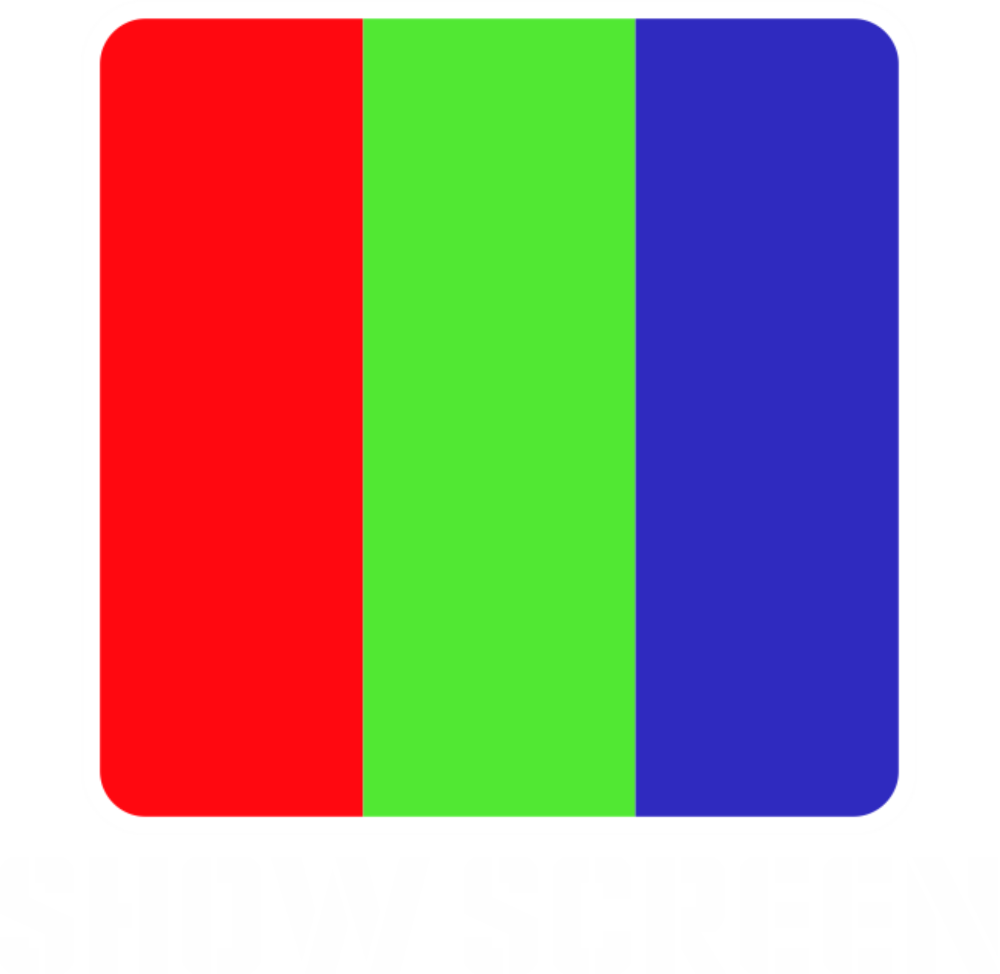
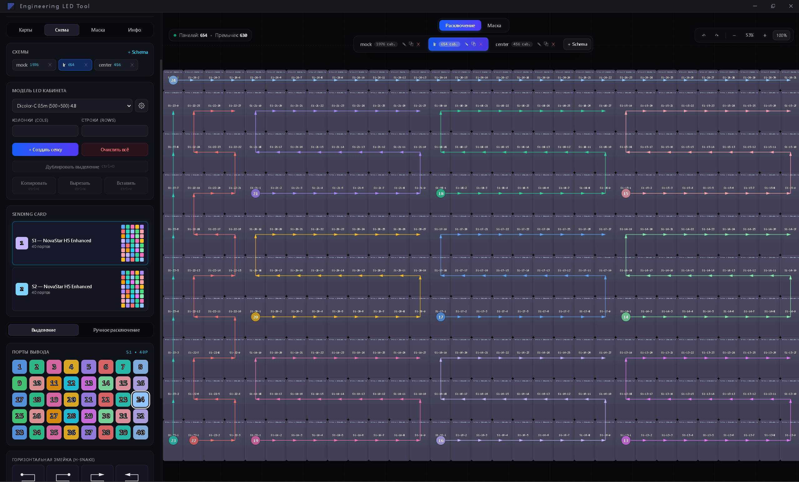
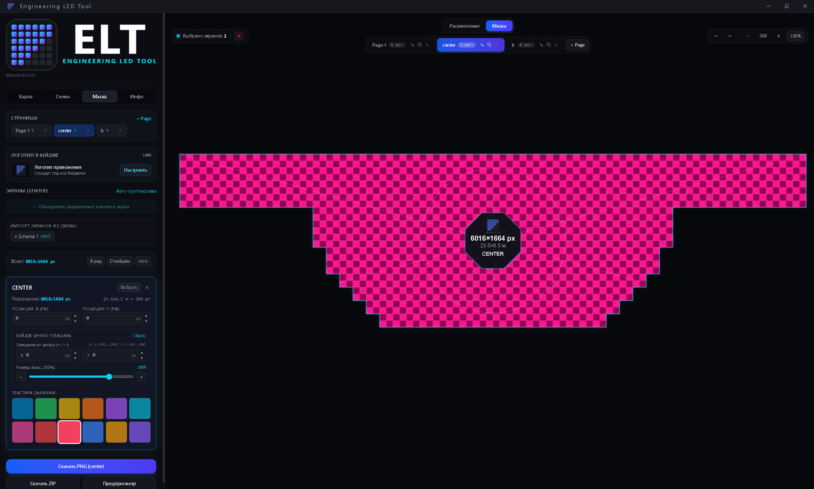
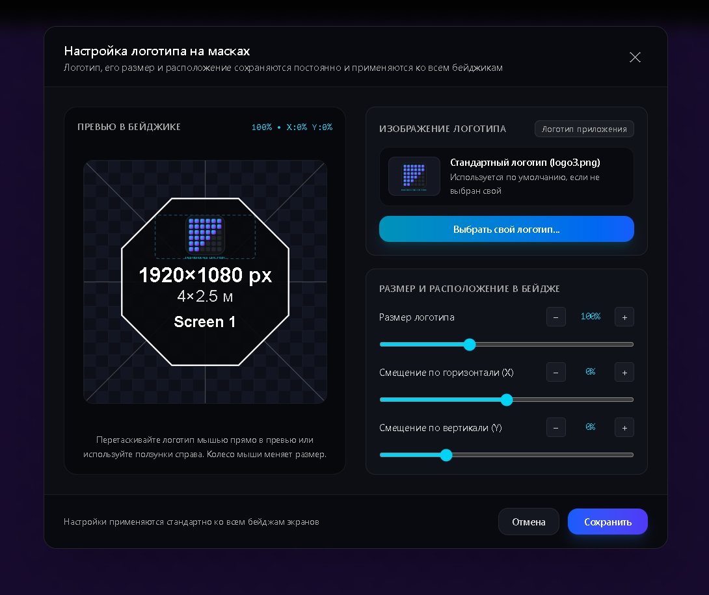
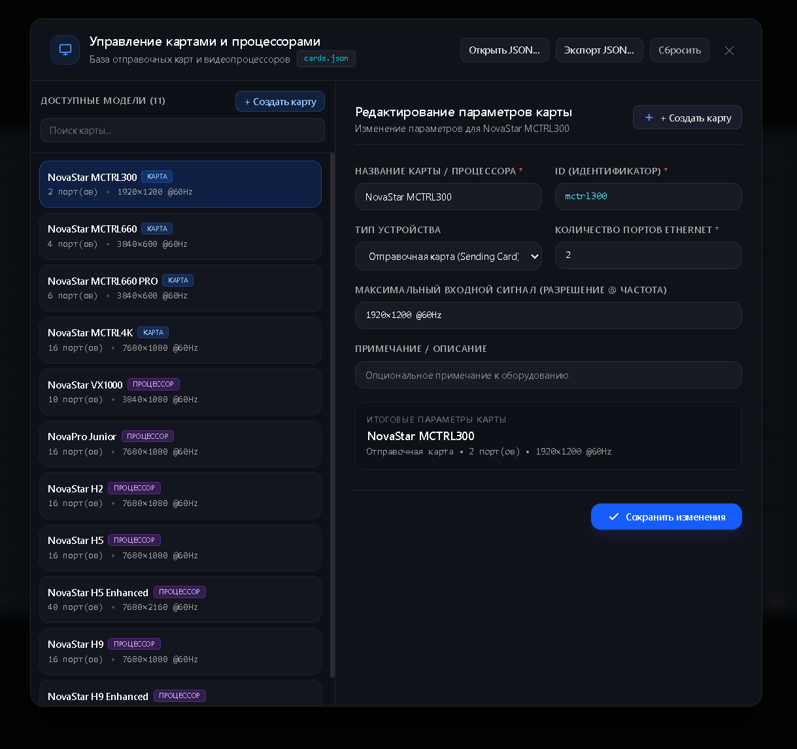
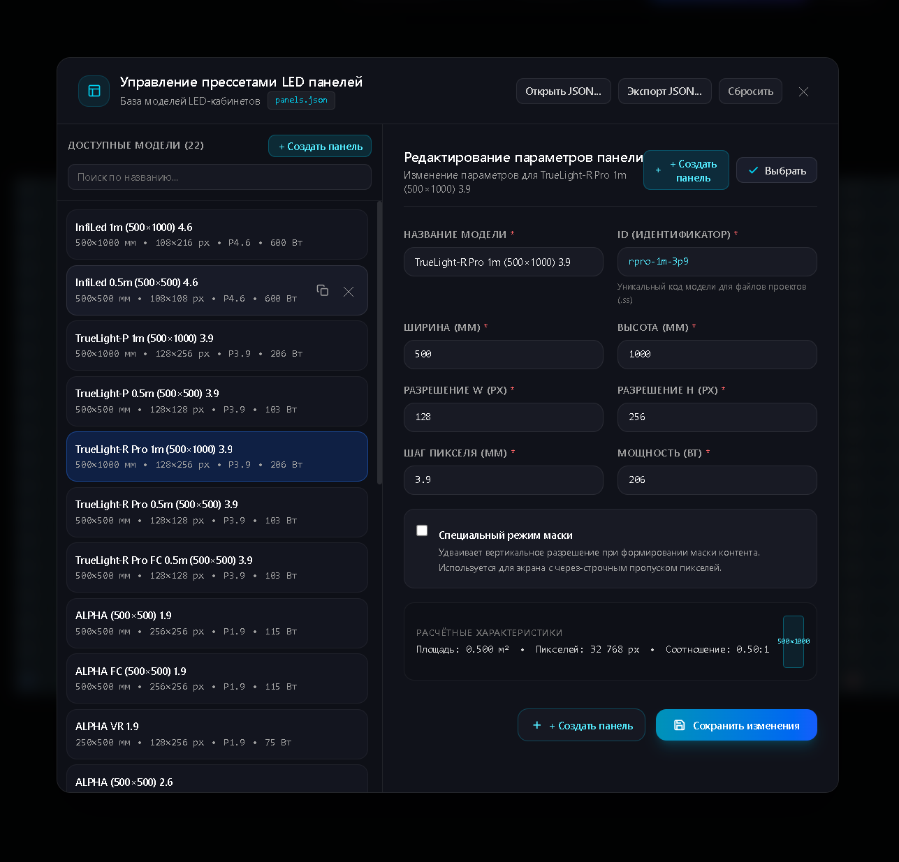
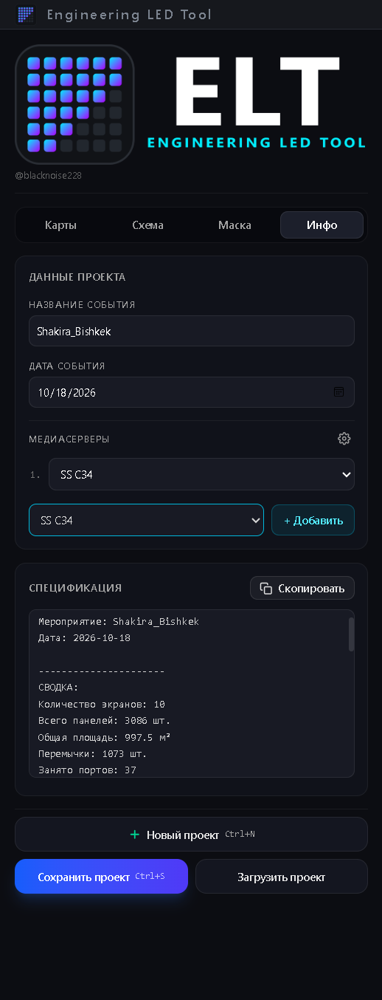

# Engineering LED Tool

<p align="center">
  
</p>

<p align="center">
  <strong>Professional tool for engineering calculations, signal wiring diagrams, and LED screen raster masks</strong>
</p>

<p align="center">
  <a href="#-download">
    
  </a>
  <a href="#-support-the-project-donationalerts">
    
  </a>
</p>

<p align="center">
  
  
  
  
</p>

<p align="center">
  <a href="README.ru.md">Читать на русском</a> | <strong>English</strong>
</p>

---

## 📌 Table of Contents

- [About The App](#-about-the-app)
- [Key Features](#-key-features)
- [Download](#-download)
- [Feature Showcase & Screenshots](#-feature-showcase--screenshots)
  - [1. Signal Wiring Diagram](#1-signal-wiring-diagram-wiring)
  - [2. Pixelmap Mask Generation & Branding](#2-pixelmap-mask-generation--branding-with-custom-logo)
  - [3. NovaStar Cards & Video Processors Presets](#3-novastar-cards--video-processors-presets)
  - [4. LED Cabinet (Panel) Presets](#4-led-cabinet-panel-presets)
  - [5. Media Server Presets](#5-media-server-presets)
  - [6. Equipment Bill of Materials & Power Calculation](#6-equipment-bill-of-materials--power-calculation)
- [Project Files (.ss)](#-project-files-ss)
- [Keyboard Shortcuts (Hotkeys)](#-keyboard-shortcuts-hotkeys)
- [Step-by-Step Quick Start Guide](#-step-by-step-quick-start-guide)
- [Building from Source](#-building-from-source)
- [Support the Project (DonationAlerts)](#-support-the-project-donationalerts)
- [License](#-license)

---

## 💡 About The App

**Engineering LED Tool** is a dedicated desktop application for video engineers, technical specialists, VJs, and rental / production companies.

The software is designed to streamline LED screen preparation for events or installations:
- Screen geometry design from modules of any size and pixel pitch.
- Clean visual wiring diagrams showing twisted-pair (Ethernet) patching between cabinets with signal direction arrows and sequential module numbers in the chain.
- Automatic pixel load limit monitoring per NovaStar controller port (for 50 Hz and 60 Hz).
- Instant calculation of equipment specifications: total cables, ports, cards, CVT optical transceivers, total surface area ($m^2$), and power consumption (kW, A).
- Creation of pixel-accurate raster masks for media servers (Resolume Arena, disguise, TouchDesigner, Watchout, Millumin) with custom brand logo integration.

---

## ⚡ Key Features

- 📐 **Interactive Canvas:** free zoom, pan, and smart snapping to edges, centers, and corners.
- 🔌 **Signal Tracing:** manual cable routing or smart "snake" auto-connection of selected cabinets with configurable step and direction.
- 🎛️ **NovaStar Ecosystem:** support for NovaStar sending cards and video processors and devices with similar per-port pixel limits.
- 🖥️ **Media Servers:** ability to add custom media servers to display in the specification.
- 🎨 **Branded Masks:** export pixel masks of screens for content preparation with custom company logo, size, and offset adjustments.
- 📋 **One-Click Specification:** generation of a detailed equipment text rider ready to send to technicians, managers, or clients in chat.
- 💾 **`.ss` Format with Windows Integration:** saving projects in a compact file with double-click opening directly from File Explorer.
- 🖼️ **High-Resolution Export:** saving diagrams to PNG and ZIP archive.

---

## 🚀 Download

The latest builds are available on the GitHub Releases page:

👉 **[Download Latest Release of Engineering LED Tool (Releases)](https://github.com/blacknoise228/ss-engineering-desktop/releases/latest)**

Two versions are available for 64-bit Windows:

| Version | File | Description |
|---|---|---|
| **Installer** | `engineering-led-tool-amd64-installer.exe` | Recommended. Installs the program into the system, creates shortcuts, and automatically registers the `.ss` project file association. |
| **Portable** | `engineering-led-tool.exe` | Zero-install portable executable. Runs from a USB flash drive or any folder. Preset configurations are saved next to the executable. |


---

## 📸 Feature Showcase & Screenshots

### 1. Signal Wiring Diagram (Wiring)

The diagram clearly displays the signal patch cable daisy chains between cabinets:
- Each sending card or video processor is highlighted with a unique color.
- Each cabinet displays its sequential number in the port's signal line.
- Real-time tracking of used pixels per port in 8-bit:
  - **50 Hz:** up to 791,667 px / port
  - **60 Hz:** up to 659,722 px / port
- One-click automatic daisy-chain wiring for selected cabinets.

<p align="center">
  
</p>

---

### 2. Pixelmap Mask Generation & Branding with Custom Logo

The **Mask** tab allows configuring screen coordinates on the canvas:
- Grouping modules into named screen groups (e.g.: *Left Banner*, *Center Stage*, *Right Column*).
- Canvas resolution automatically adjusts to the screens placed on it.
- **Custom company logo:** ability to upload your production or rental company logo to be displayed on screen badges.
- Logo settings:
  - Image upload (PNG / SVG).
  - Scale and offsets (X/Y Offset).
- Export ready masks in high resolution pixel-to-pixel.

<p align="center">
  
</p>

<p align="center">
  
</p>

---

### 3. NovaStar Cards & Video Processors Presets

The **Cards** tab and presets dialog allow adding the cards you use:
- Add and rename controllers.
- Specify device type: Sending Card or Video Processor.
- Configure maximum number of physical Ethernet ports.
- Add NovaStar CVT fiber optic transceivers to equipment lists (CVT10, CVT4K-S) with custom preset manager (`fibers.json`).
- Import and export controller presets database in JSON format (`cards.json`).

<p align="center">
  
</p>

---

### 4. LED Cabinet (Panel) Presets

The application allows creating cabinet presets:
- **Preset parameters:**
  - Model name (e.g., *Dicolor-C 500×1000 4.8mm*).
  - Physical dimensions: width and height in millimeters (mm).
  - Resolution: width and height in pixels (px).
  - Pixel pitch (Pixel Pitch, mm).
  - Power consumption per cabinet (W).
  - Special shape flag (Special panel) for LED mesh / curtains with interlaced pixel skipping.
- Database management: add, duplicate, delete, export, and import presets to/from `panels.json`.

<p align="center">
  
</p>


---

### 5. Media Server Presets

You can manage the list of media servers used in the project:
- Pre-configured profiles used by our company, with the ability to add your own.
- Add custom servers specifying hardware configuration and notes.
- Export and import server profiles to/from `servers.json`.

---

### 6. Equipment Bill of Materials & Power Calculation

The **Info** tab instantly generates a complete technical report:
- Event Name and Date.
- **Summary:**
  - Number of physical screens and total cabinet count (pcs).
  - Total surface area of the LED canvas in square meters ($m^2$).
  - Number of inter-panel jumpers (RJ45 patch cords).
  - Total number of controller ports utilized.
- **Cabinet model breakdown:** exact count for every module type.
- **List of controllers/cards:** list of active cards and added CVT optical transceiver units.
- **Power Calculation (Mains):**
  - Total power consumption in kW and W.
  - Calculated current for 3-phase 230V connection (in Amperes per phase).
- **Assigned Media Servers:** assigned server or machine pool.
- **"Copy Specification"** button to quickly paste formatted text into messenger chats, technical riders, or estimates.

<p align="center">
  
</p>

#### Example Generated Report:

```text
СПЕЦИФИКАЦИЯ ОБОРУДОВАНИЯ

Мероприятие: Stadium Show 2026
Дата: 2026-10-23

----------------------
СВОДКА:
Количество экранов: 3
Всего панелей: 160 шт.
Общая площадь: 40.00 м²
Перемычки: 154 шт.
Занято портов: 6

----------------------
ЭКРАНЫ
• Main Screen: 120 панелей
• Left Wing: 20 панелей
• Right Wing: 20 панелей

----------------------
МОДЕЛИ ПАНЕЛЕЙ
• Dicolor-C 0.5m (500×500) 4.8: 80 шт.
• Dicolor-C 1m (500×1000) 4.8: 80 шт.

----------------------
КАРТЫ
• S1 — NovaStar VX1000

CVT
• NovaStar CVT10: 1 шт.

----------------------
ЭЛЕКТРОПИТАНИЕ (СИЛА)
Потребление: 38.64 кВт (38640 Вт)
Ток (3 фазы, 230В): 56.00 A

----------------------
МЕДИАСЕРВЕРЫ
Сервер: HP Z4
```

---

## 📁 Project Files (`.ss`)

Engineering LED Tool saves the complete project structure in files with its proprietary extension **`.ss`**:
- The file stores all wiring pages, mask pages, bound controllers, cable routing, presets, and event metadata.
- The installer registers the `.ss` file association in Windows — open any project with a double click from File Explorer.
- Full Drag & Drop support and single-instance application handling (opening another file does not launch a redundant process, but passes the project into the already running window).
- Projects are also compatible with `.json` format.


---

## ⌨️ Keyboard Shortcuts (Hotkeys)

For convenience, the editor provides full shortcut support:

| Action | Shortcut (EN / RU) |
|---|---|
| **Save Project** | `Ctrl + S` |
| **Save Project As...** | `Ctrl + Shift + S`|
| **New Project** | `Ctrl + N` |
| **Undo** | `Ctrl + Z`  |
| **Redo** | `Ctrl + Y` or `Ctrl + Shift + Z` |
| **Select All Panels** | `Ctrl + A` |
| **Copy Selected** | `Ctrl + C` |
| **Cut Selected** | `Ctrl + X` |
| **Paste** | `Ctrl + V` |
| **Duplicate Selected Panels** | `Ctrl + D` |
| **Delete Selected Elements** | `Delete` or `Backspace` |
| **Export Scheme to PNG** | `Ctrl + E` |
| **Canvas Navigation** | `Shift + Left Mouse Button` |
| **Cancel Cable Mode / Clear Selection** | `Escape` or Right-Click |

---

## 🛠️ Step-by-Step Quick Start Guide

1. **Creating and Arranging Panels:**
   - Go to the **Panels** tab in the sidebar.
   - Select a cabinet preset and configure grid dimensions ($Cols \times Rows$ panels).
   - Click **Add Grid** or click on the canvas for free placement.
2. **Positioning:**
   - Drag panels with the mouse. They snap automatically to edges and centers.
   - Use marquee selection to move groups of cabinets simultaneously.
3. **Assigning Controllers:**
   - In the **Cards** tab, add the required processor (e.g., *NovaStar VX1000*).
   - Select the active card and Ethernet port.
4. **Wiring:**
   - Enable the cable connection tool or use "Snake" auto-connection.
   - Connect cabinets in the required sequence.
5. **Creating Masks:**
   - Switch to the **Mask** tab.
   - Click **Add Screen from Wiring** to import screen contours.
6. **Exporting Results:**
   - In the **Info** tab, copy the generated equipment specification.
   - Press `Ctrl + E` to save the scheme as PNG or export masks to ZIP.

---

## 💻 Building from Source

If you want to build the application from source code yourself:

### Prerequisites
- [Go 1.21+](https://go.dev/)
- [Node.js 18+](https://nodejs.org/)
- [Wails CLI v2](https://wails.io/docs/gettingstarted/installation)

### Instructions

```bash
# 1. Clone the repository
git clone https://github.com/blacknoise228/engineering-led-tool.git
cd engineering-led-tool

# 2. Install frontend dependencies
cd frontend
npm install
cd ..

# 3. Run in live development mode
wails dev

# 4. Build final binary and installer for Windows
wails build -platform windows/amd64 -nsis
```

The built installer and portable `.exe` will appear in the `build/bin/` folder.

---

## ☕ Support the Project (DonationAlerts)

If **Engineering LED Tool** helps you in your work, saves time when preparing for projects, performing calculations, and patching screens, you can support the project and motivate the development of new useful features:

❤️ **[Support the Creator on DonationAlerts](https://www.donationalerts.com/r/blacknoise228)**


---

## 📄 License

This project is licensed under the free software **[GNU General Public License v3.0 (GPL-3.0)](LICENSE)**.

This is a copyleft license that **mandates open source distribution**:
- Any modifications, derivative works, or forks of the application when distributed **must** also be licensed under GPL-3.0 with complete corresponding source code made publicly available.
- Creating closed-source proprietary commercial versions based on this code without publishing source code is strictly prohibited.
- Anyone receiving the compiled binaries has the legal right to access and obtain the complete source code.

